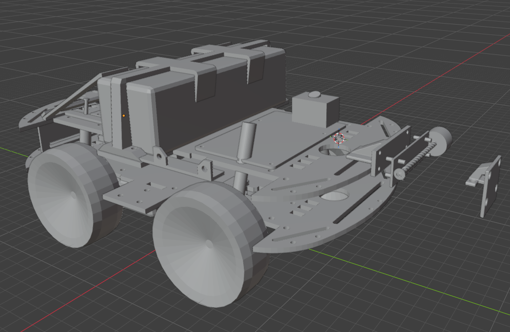

# MAFIL

**MAFIL** (Movement Autonomous Feedback Image Learning) is a small robot-car build: a Raspberry Pi, motors and sensors, a camera, and on-device object detection.

**Matt Harmer** · Lake Macquarie, NSW · [LinkedIn](https://www.linkedin.com/in/matt-harmer-me/) · [GitHub](https://github.com/mattharmer/mafil)

---

## Problem

I wanted a vehicle that could move under program control, notice something in front of it, and change what it did next — stop, record, or start a simple audio menu if a person was detected — rather than only being driven by a remote.

## What I built

On a Raspberry Pi (the build notes are for Raspberry Pi OS), I wrote modular Python for:

- Motor and encoder control, including travel over a set encoder count
- A sonar-triggered pause in the path so the camera can look at an object
- TensorFlow Lite object detection with the EfficientDet-Lite0 model, and a path for a Coral Edge TPU model if the accelerator is attached
- Recording while a person is in view, and a short audio menu when a known person is detected
- Supporting modules for audio play/record, a stepper, and saving images

A Fritzing schematic, a parts list, written wiring notes, and a Blender model of the robot are in `hardware/`.

*Blender model of the MAFIL chassis*

There is also an early Python voice-assistant experiment in `assistant/`. It follows published tutorials (linked in that folder's README) and is not the main robot codebase. Run it with a local `.env` file; a template is in `assistant/.env.example`. **Do not commit a real `.env`.**

## What's in this repository

| Path | What's there |
| --- | --- |
| `mafilMain.py` and `module*.py` | Robot workspace: movement, detection, audio, motors |
| `efficientdet_lite0.tflite` | Object-detection model used on the Pi |
| `efficientdet_lite0_edgetpu.tflite` | Edge TPU variant, if a Coral accelerator is attached |
| `hardware/` | Blender model, Fritzing schematic, parts list and build notes |
| `images/` | Blender viewport render of the chassis |
| `assistant/` | Early voice-assistant experiment (environment variables only; no secrets in the repo) |

I do not have photographs of the built robot to hand. The Blender model is the visual record of the chassis for now.

## What this shows

- I will take a system made of parts — motors, sensors, a camera, a model — and keep going until the pieces talk to each other
- I document wiring, modules and how to run the stack, not only the happy-path demo
- For a client-manager role, this is practical curiosity: when something in the loop is wrong, I want to understand why, and I will leave a record someone else can follow

## Licence

MIT. See `LICENSE`.
